# Studentų pažymių skaičiavimo programa

## v0.3 – vector ir list spartos tyrimas

Palyginau vector ir list konteinerių spartą apdorojant 1000, 10000, 100000, 1000000 ir 10000000 studentų failus.

Kiekvieną failą su abiem konteineriais išbandžiau po 3 kartus. Visuose bandymuose studentai buvo skirstomi pagal galutinio pažymio vidurkį ir rūšiuojami pagal pavardę.

### Kompiuterio parametrai

- CPU: AMD Ryzen 5 220
- RAM: 16 GB DDR5
- SSD: 480 GB NVMe

### Testavimo rezultatai

Lentelėje pateikti 3 bandymų vidurkiai sekundėmis.

| Studentai | Konteineris | Skaitymas | Skirstymas | Rūšiavimas | Rašymas |
|---|---|---:|---:|---:|---:|
| 1000 | vector | 0.0154 | 0.0007 | 0.0030 | 0.0214 |
| 1000 | list | 0.0062 | 0.0006 | 0.0006 | 0.0031 |
| 10000 | vector | 0.0402 | 0.0061 | 0.0442 | 0.0125 |
| 10000 | list | 0.0411 | 0.0044 | 0.0053 | 0.0143 |
| 100000 | vector | 0.4275 | 0.0523 | 0.5872 | 0.1162 |
| 100000 | list | 0.4517 | 0.0483 | 0.0800 | 0.1331 |
| 1000000 | vector | 3.6866 | 0.6582 | 6.1325 | 1.0118 |
| 1000000 | list | 3.7840 | 0.5130 | 1.1225 | 1.5772 |
| 10000000 | vector | 48.5395 | 5.0087 | 65.8691 | 9.6691 |
| 10000000 | list | 49.6147 | 4.4198 | 10.8572 | 11.0980 |

### Išvados

Atliekant bandymus pastebėjau, kad list konteineris gerokai greičiau rūšiuoja studentus, ypač esant dideliam jų skaičiui. Tuo tarpu vector dažniausiai buvo greitesnis skaitant ir rašant failus.

Pagal bendrą apdorojimo laiką mano programoje geresnius rezultatus parodė list konteineris.

## Testavimo nuotraukos

### 1000 studentų

**Vector**

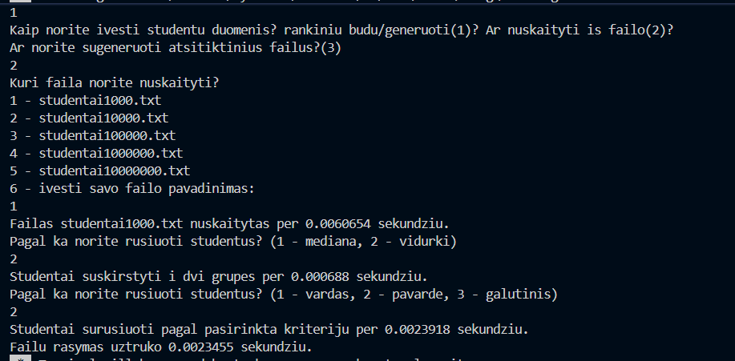

**List**

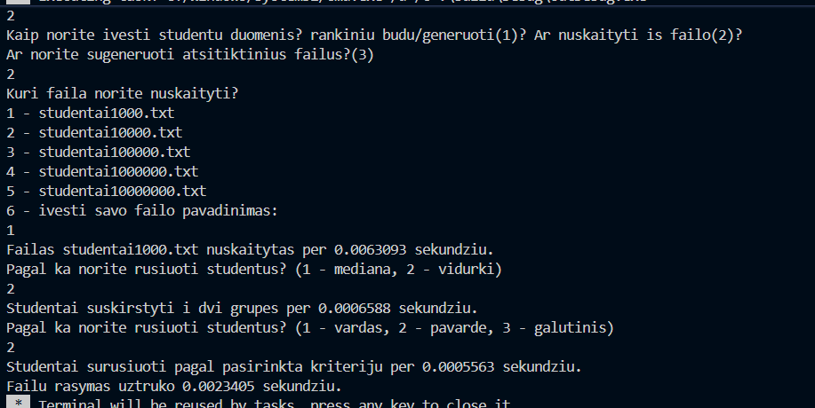

### 1 000 000 studentų

**Vector**

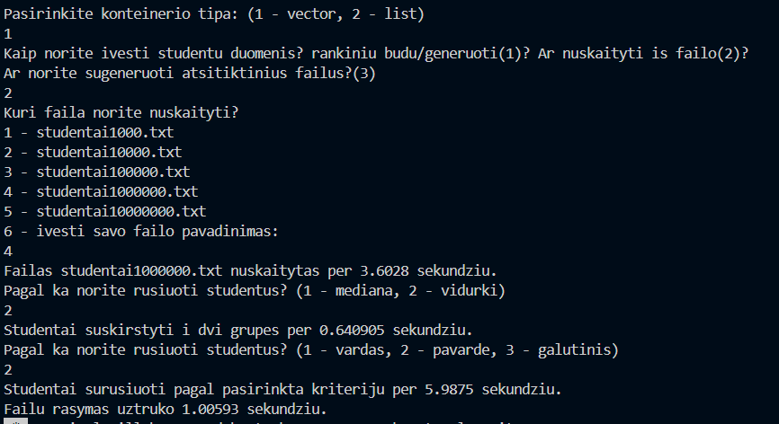

**List**

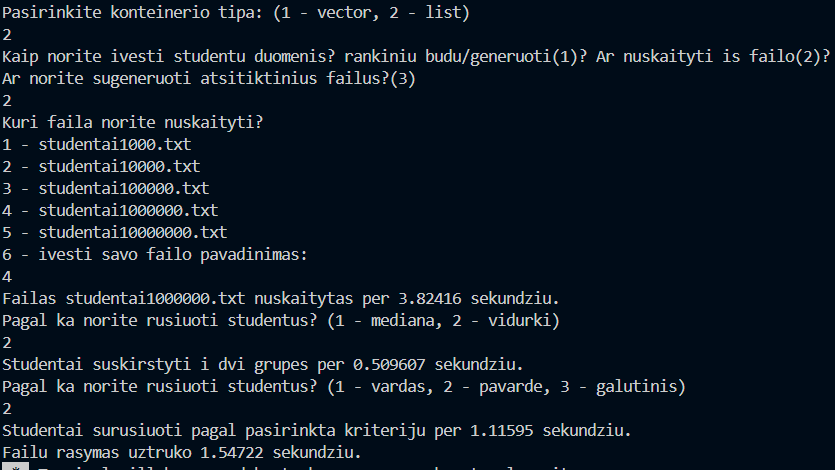

### 10 000 000 studentų

**Vector**

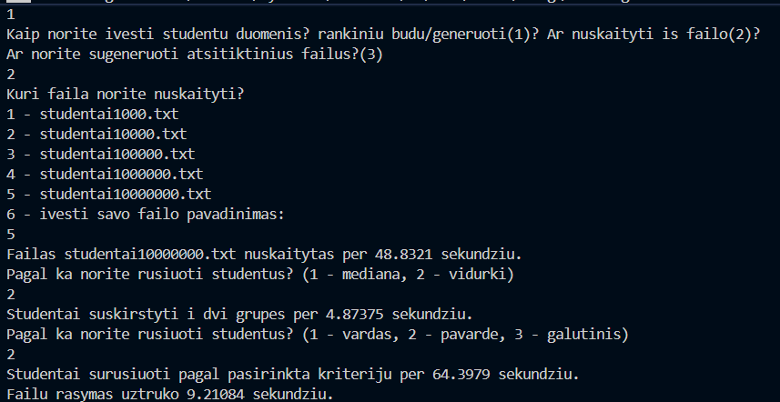

**List**

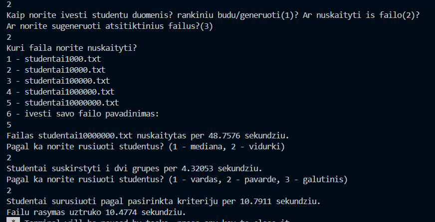

## v1.0 – Studentų skirstymo optimizavimas

Šioje versijoje buvo realizuotos ir palygintos trys studentų skirstymo į vargšiukus ir kietiakus strategijos, naudojant std::vector ir `std::list` konteinerius.

### Skirstymo strategijos

**1 strategija:** Studentai skirstomi į du naujus konteinerius – vargšiukus ir kietiakus. Pradinis studentų konteineris lieka nepakeistas.

**2 strategija:** Sukuriamas tik vienas naujas konteineris vargšiukams. Studentai, kurių galutinis balas mažesnis nei 5, perkeliami į šį konteinerį ir pašalinami iš pradinio. Pradiniame konteineryje lieka kietiakai.

**3 strategija:** Optimizuota antroji strategija. vector atveju naudojamas std::partition algoritmas, o list atveju – splice() metodas, leidžiantis perkelti elementus jų nekopijuojant.

### Testavimo metodika

Testavimas atliktas su 1 000, 10 000 ir 100 000 studentų failais. Visi bandymai atlikti naudojant tuos pačius iš anksto sugeneruotus duomenis.

- Vertinimo kriterijus: galutinis balas pagal medianą.
- Kiekviena strategija išmatuota 5 kartus.
- Lentelėse pateikiamas 5 matavimų aritmetinis vidurkis.
- Matuotas tik studentų skirstymo laikas, neįtraukiant failų skaitymo, konteinerio pradinio kopijavimo ir rezultatų įrašymo.

### Testavimo rezultatai

#### 1 000 studentų

| Strategija | Vector (s) | List (s) |
|---|---:|---:|
| 1 | 0.00013338 | 0.00017864 |
| 2 | 0.00124310 | 0.00005228 |
| 3 | 0.00003930 | 0.00001678 |

#### 10 000 studentų

| Strategija | Vector (s) | List (s) |
|---|---:|---:|
| 1 | 0.00084262 | 0.00133798 |
| 2 | 0.10790800 | 0.00042672 |
| 3 | 0.00036408 | 0.00009348 |

#### 100 000 studentų

| Strategija | Vector (s) | List (s) |
|---|---:|---:|
| 1 | 0.01462300 | 0.01922810 |
| 2 | 11.46880000 | 0.00912214 |
| 3 | 0.00876394 | 0.00371986 |

### Rezultatų analizė

Pagal gautus rezultatus greičiausiai veikė 3 strategija su abiem konteineriais. Lėčiausia buvo 2 strategija su vector, nes trinant studentus reikia perstumti likusius elementus. Su list ši problema nepasireiškia, todėl jis veikė greičiau.

3 strategijoje naudojami partition ir splice metodai leido pasiekti geresnius rezultatus. Didėjant studentų skaičiui, skirtumai tarp strategijų tapo dar didesni.

### Išvados

Atlikus bandymus matyti, kad programos greitis priklauso ne tik nuo konteinerio, bet ir nuo pasirinktos skirstymo strategijos. Visuose atliktuose bandymuose geriausiai pasirodė 3 strategija.

### Testavimo nuotraukos

1000 studentų, vector:

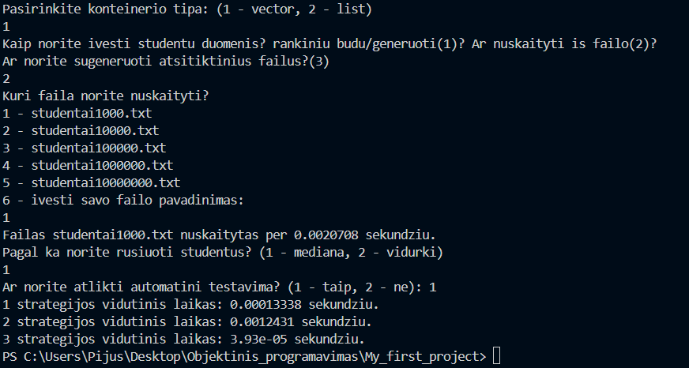

1000 studentų, list:

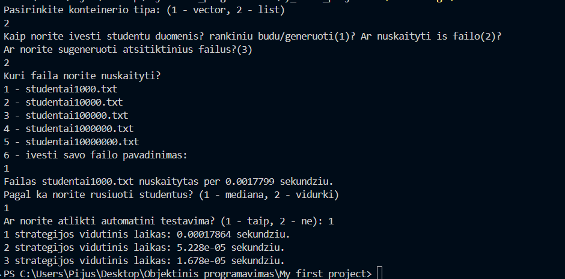

10 000 studentų, vector:

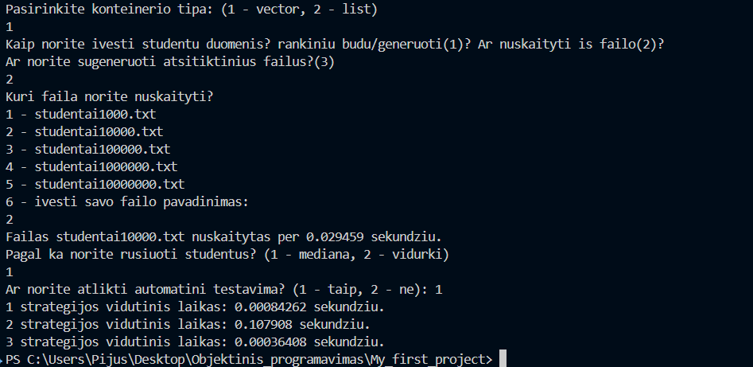

10 000 studentų, list:

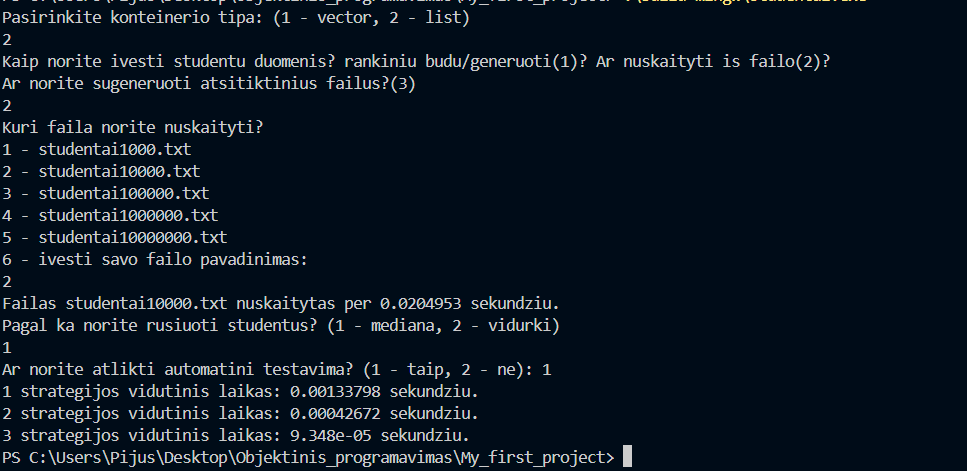

100 000 studentų, vector:

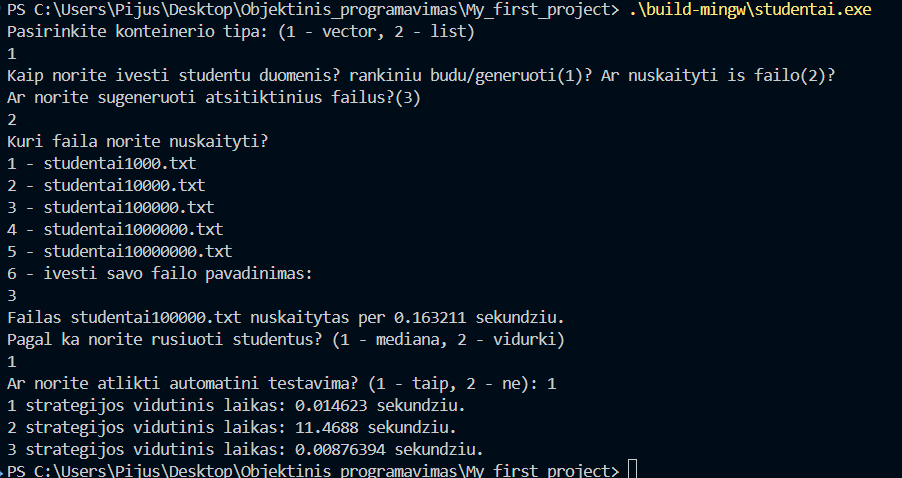

100 000 studentų, list:

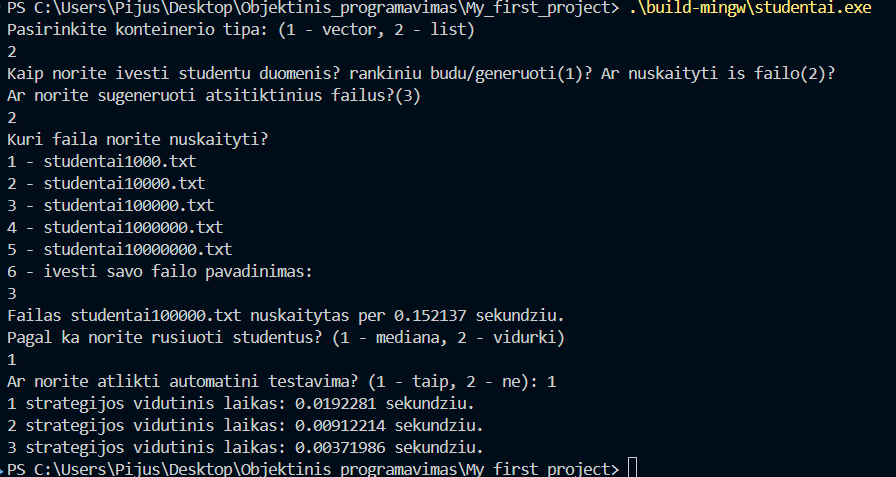

### Programos diegimas ir paleidimas

Programai sukompiliuoti naudojamas CMake ir C++ kompiliatorius MinGW.

Terminale vykdomos komandos:

    cmake -S . -B build-mingw -G "MinGW Makefiles" -DCMAKE_BUILD_TYPE=Release

    cmake --build build-mingw

Programa paleidžiama komanda:

    .\build-mingw\studentai.exe

Paleidus programą galima pasirinkti vector arba list konteinerį, duomenų įvedimo būdą ir studentų skirstymo strategiją. Taip pat galima atlikti automatinį strategijų greičio testavimą.